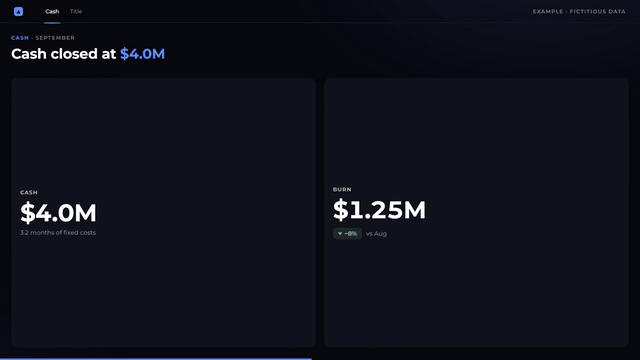
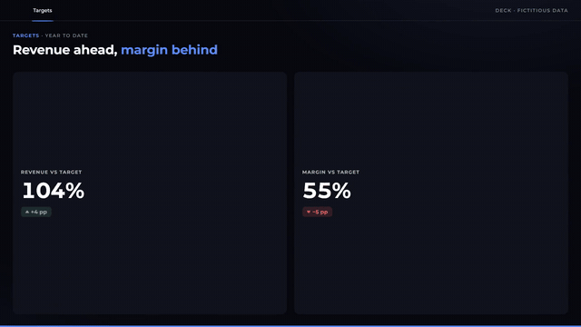
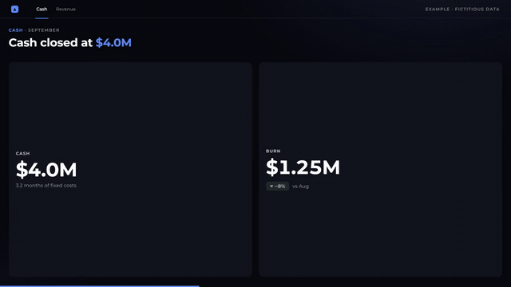
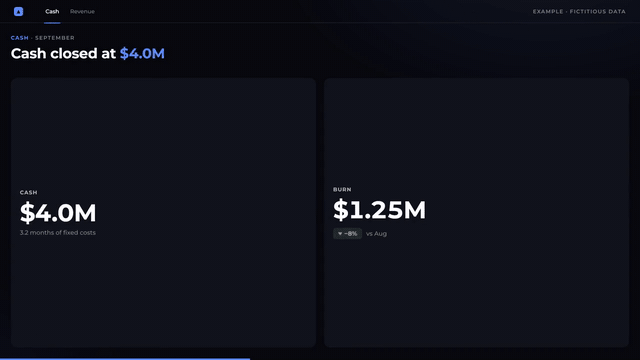

# llm-video-engine
[](https://hub.xerj.org/contributors/gmdkaio)

Turns an HTML presentation deck into a short animated video summary.
An LLM reads the deck and writes a render plan (JSON plus assets).
A local C++ engine turns that plan into the video, with no LLM, browser or
network involved.

## Status

Early. The engine renders plans written in the `llm-video-engine/plan@1` format
(`schema/plan.schema.json`, documented in `skill/COMPONENTS.md`), and the skill
in `skill/` analyzes a deck and writes such a plan. Narration audio and vertical
video are not built yet.

## Charts, tables and KPIs

There is no fixed list of chart types. A chart in the plan is layers of marks
(bars, lines, areas, rects, rules, points, texts, arcs, ribbons, paths), so the
LLM can rebuild whatever chart the deck has with its own data and highlight.
KPI cards and tables (income statements, rankings) are components of their own.
Some examples, rendered by the engine from fictitious plans:

<!-- charts:start -->
<table>
<tr>
<td width="50%" valign="top">
<br>
<b>KPI cards</b><br>
Values count up, deltas pop in with their arrow and tone, sparklines draw.
</td>
<td width="50%" valign="top">
<br>
<b>Income statement table</b><br>
Rows enter in order, totals in bold, then the cost line and the month are highlighted.
</td>
</tr>
<tr>
<td width="50%" valign="top">
<br>
<b>Waterfall</b><br>
From opening to closing balance, step by step; the biggest drops dim the rest.
</td>
<td width="50%" valign="top">
<br>
<b>Bars, cumulative line and target</b><br>
Daily bars, the running total drawn over them, a dashed projection and the target rising into place.
</td>
</tr>
<tr>
<td width="50%" valign="top">
<br>
<b>Stacked bars</b><br>
Series pile up per category with the deck's own shades and a legend.
</td>
<td width="50%" valign="top">
<br>
<b>Scenario lines</b><br>
One line per scenario, threshold rules and labels at the line ends.
</td>
</tr>
<tr>
<td width="50%" valign="top">
<br>
<b>Donut</b><br>
Arcs sweep in order and the center counts up to the share that matters.
</td>
<td width="50%" valign="top">
<br>
<b>Gauge</b><br>
Colored bands, a needle that swings from last value to this one, and a counter.
</td>
</tr>
<tr>
<td width="50%" valign="top">
<br>
<b>Flow (Sankey)</b><br>
Inflow split into ribbons that curve to each outflow, and what is left over.
</td>
<td width="50%" valign="top">
<br>
<b>Dual axis</b><br>
Bars on the left scale, a percentage line on its own scale on the right.
</td>
</tr>
<tr>
<td width="50%" valign="top">
<br>
<b>Radar</b><br>
Two profiles over the same axes, filled shape growing from the center.
</td>
<td width="50%" valign="top">
<br>
<b>Scatter and bubbles</b><br>
Points on two value scales, bubble size per point, and a ping on the outlier.
</td>
</tr>
<tr>
<td width="50%" valign="top">
<br>
<b>Heatmap</b><br>
One cell per pair, intensity as opacity, rows labelled on the left.
</td>
<td width="50%" valign="top">
<br>
<b>Gantt</b><br>
Horizontal bars from start to end per task, and a rule for today.
</td>
</tr>
<tr>
<td width="50%" valign="top">
<br>
<b>Funnel</b><br>
Closed shapes narrowing stage by stage, with the counts inside.
</td>
<td width="50%" valign="top">
<br>
<b>Bullet</b><br>
Value against its ranges and target, one row per metric.
</td>
</tr>
</table>
<!-- charts:end -->

The GIFs come from `node tools/readme_charts.mjs`.

## How it is used

1. The LLM, with the skill, reads the deck and returns `video-plan.zip`: the plan,
   the logos it uses and the narration text. It never renders video.
2. On your machine:

```
llm-video-engine validate video-plan.zip   # layout problems, one pasteable line each
llm-video-engine grid video-plan.zip       # one frame per scene
llm-video-engine render video-plan.zip     # the MP4
```

Render options: `--encoder qsv` (Intel Quick Sync) or `--encoder nvenc` (NVIDIA) to
encode on the GPU, `--shutter N` for motion blur (N sub-frames per frame, 4 for drafts,
8 for finals), `--threads N`.

On Windows the engine builds to `engine/build/release/`. Add that folder to your PATH
once so the commands above work from anywhere (PowerShell, then open a new terminal):

```
[Environment]::SetEnvironmentVariable('Path', [Environment]::GetEnvironmentVariable('Path', 'User') + ';' + (Resolve-Path engine\build\release), 'User')
```

On Linux, link the binary into a folder on your PATH:

```
ln -s "$PWD/engine/build/linux-native/llm-video-engine" ~/.local/bin/
```

To install the skill in Claude, build its zip with `node tools/package_skill.mjs`
and upload `dist/llm-video-engine-skill.zip`.

## Building

The engine needs CMake 3.25+, Ninja and [vcpkg](https://github.com/microsoft/vcpkg)
(`VCPKG_ROOT` set); vcpkg builds Skia, HarfBuzz and nlohmann-json on the first configure.
ffmpeg must be on PATH to render.

| Preset | Platform | Use |
|---|---|---|
| `release` | Windows, MSVC | the Windows build (load MSVC first: `. engine\scripts\dev-env.ps1`) |
| `linux` | Linux, system compiler | portable; the baseline binary bundled in the skill for Claude's sandbox |
| `linux-v3` | Linux, system compiler | `-march=x86-64-v3` (AVX2); bundled next to `linux`, and the skill runs it when the CPU supports it |
| `linux-native` | Linux, clang | tuned for the machine it is built on (`-march=native`, Skia included); not portable |

```
cd engine
cmake --preset linux-native
cmake --build --preset linux-native
```

On Linux, Skia's build also needs `nasm`, `pkg-config`, Python 3 and the fontconfig,
OpenGL and X11 development headers (see `.github/workflows/linux-bundle.yml`).

## Motion

Plans animate in the classic style by default. `config.motion: "measured"` switches the
whole video to a grammar of shorter, decelerating moves: titles build word by word with a
short directional smear, panels land in about 12 frames instead of fading and bouncing,
counters step once per frame with steps that shrink, scenes leave on an accelerating exit,
the intro logo arrives oversized and dives into the cut, slide-scene camera moves snap in
one frame and settle, and the page creeps so a held frame is never dead.
`config.transition: "whip"` joins scenes with whip pans, and `config.clock: "twos"` holds
every pose for two frames, for a hand-posed look. See `skill/COMPONENTS.md`.

<!-- motion:start -->
<table>
<tr>
<td width="50%" valign="top">
<br>
<b>Titles, word by word</b><br>
Each word lands whole with a short smear: a beat after the first, quick in the middle, a slower step into the last.
</td>
<td width="50%" valign="top">
<br>
<b>Panels land, counters step</b><br>
Panels arrive in about 12 frames and stop; the counter changes once per frame, in steps that shrink.
</td>
</tr>
<tr>
<td width="50%" valign="top">
<br>
<b>Intro: oversized logo, then a dive</b><br>
The logo arrives too big and settles, then multiplies its scale every frame into the cut.
</td>
<td width="50%" valign="top">
<br>
<b>Accelerating exits</b><br>
Scenes leave by speeding up, at full speed on the cut, instead of easing out.
</td>
</tr>
<tr>
<td width="50%" valign="top">
<br>
<b>Camera snaps</b><br>
On a captured deck tab the camera covers most of each move in one frame, then settles.
</td>
<td width="50%" valign="top">
<br>
<b>Whip transitions</b><br>
<code>transition: "whip"</code>: the old scene whips out at full speed and the new one cuts in already moving.
</td>
</tr>
<tr>
<td width="50%" valign="top">
<br>
<b>On twos</b><br>
<code>clock: "twos"</code> holds every pose for two frames, for a hand-posed look.
</td>
<td width="50%" valign="top">
<br>
<b>Motion blur</b><br>
<code>--shutter 8</code> averages sub-frames over a 180° shutter, so fast moves blur by their own speed.
</td>
</tr>
</table>
<!-- motion:end -->

The GIFs come from `node tools/readme_motion.mjs` (25 fps, so single-frame moves survive).

The eases and much of this grammar are ported from
[motionmaxxing](https://github.com/Tejashmakwana/motionmaxxing) by Tejas Makwana
(Apache-2.0), whose curves are fitted to moves measured in human-made films
(`engine/src/motion/`).

## Benchmark

Render time for the same video, produced two ways on the same machine:

- **HTML path:** the scenes as an HTML/GSAP page, captured frame by frame in
  headless Chrome (seek, JPEG screenshot), then encoded with x264. This is how
  the videos were made before this project.
- **llm-video-engine:** the same scenes as a plan, drawn natively with Skia on
  12 threads and piped to ffmpeg.

Test video: a real 131 s monthly-results summary (9 scenes with charts,
counters and a cash-flow diagram), 1920×1080 at 30 fps, 3,932 frames. Both paths
use the same scene timing. Frames were compared side by side at the end of every
scene and at 8 points mid-animation, and match.

| Path | Encoder | End to end | Speedup |
|---|---|---|---|
| HTML path (headless Chrome) | x264 medium, crf 18 | 627.6 s | 1× |
| llm-video-engine | x264 medium, crf 18 | 125.7 s | 5.0× |
| llm-video-engine | Intel Quick Sync (h264_qsv) | 73.3 s | 8.6× |

Machine: Intel Core i5-1235U (10 cores, 12 threads), 8 GB RAM, Windows 11,
ffmpeg 9.0.1. One run per path; on this laptop, run-to-run variation is around
15%, so read the speedups as approximate.

Where the time goes: the engine draws frames at about 91 fps on its own, so with
x264 the CPU is shared between drawing and encoding. Quick Sync moves encoding
to the integrated GPU (SSIM 0.9992 against 0.9997 for x264 crf 18, file about
30% smaller). Skia is built with MSVC there, which leaves out its fastest CPU paths.

### Linux

The renderer was then tuned on a faster machine: AMD Ryzen 5 5600X (6 cores, 12
threads, AVX2, 32 MB L3), 16 GB RAM, NVIDIA RTX 4060, Arch Linux, ffmpeg 9.0.1.
Test video: a 28 s, 5-scene plan (intro, KPI panel with a counter, bullet chart, a slide
with camera moves, outro), 1920×1080 at 30 fps, 844 frames. Wall-clock time of the
whole command, median of 3 runs.

| Build | Encoder | Time | fps |
|---|---|---|---|
| before, portable | none (draw only) | 3.47 s | 243 |
| after, portable (`linux`) | none (draw only) | 1.67 s | 505 |
| after, native (`linux-native`) | none (draw only) | 1.04 s | 815 |
| before, portable | x264 medium, crf 18 | 13.02 s | 65 |
| after, native | x264 medium, crf 18 | 7.22 s | 117 |
| after, native | NVENC (h264_nvenc) | 3.80 s | 222 |
| after, native, `--shutter 8` | NVENC | 8.60 s | 98 |

What changed, each found by profiling the 12-thread render:

- **Strips.** Frames are drawn 64 rows at a time. A whole 1080p frame is 8 MB, and
  with one per thread plus full-frame layers the working set left the CPU cache, so
  more threads made rendering slower. A strip and its layers stay in cache.
- **Native build.** The `linux-native` preset builds Skia and the engine with clang and
  `-march=native`, so Skia uses its AVX2 pipeline instead of SSE2 (about 2x per thread).
- **Allocator.** Layers were large allocations that glibc mapped and unmapped every
  frame, serializing the threads on the kernel's memory map; they are now kept in the
  heap for reuse (about 1.5x with 12 threads).
- **YUV in the engine.** Each strip is converted to YUV 4:2:0 while it is in cache, so
  ffmpeg receives 3 MB per frame instead of 8 MB and skips its own conversion.

With x264 the encoder is now the limit; NVENC matches x264's quality on this video
(SSIM 0.9995 against the earlier output) with files about 1.75x larger.

Not measured yet: LLM tokens, wall-clock time and iterations per video with and
without the engine.

## Layout

- `engine/` C++ render engine (`llm-video-engine render | grid | frame | validate`);
  `engine/src/motion/` holds the measured eases and moves
- `schema/` JSON Schema for the plan
- `skill/` the LLM side: deck analysis, plan format, plan validator
- `themes/default/` default font (Montserrat, OFL)
- `examples/` example plans, fictitious data only
- `tools/` helper scripts (`package_skill.mjs` builds the skill zip)

## License

[MIT](LICENSE).
